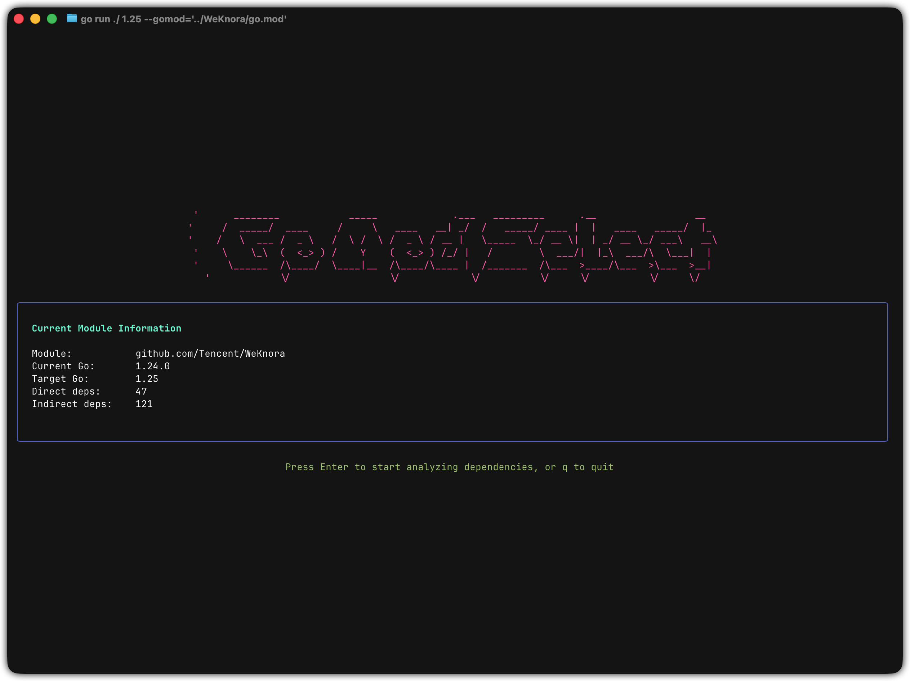
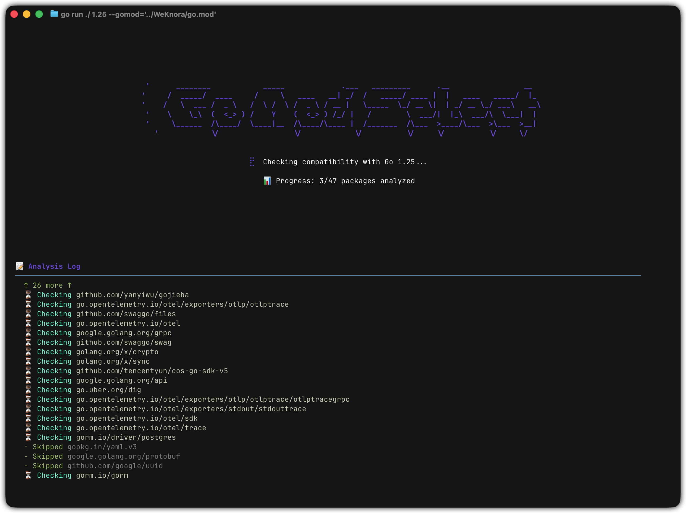
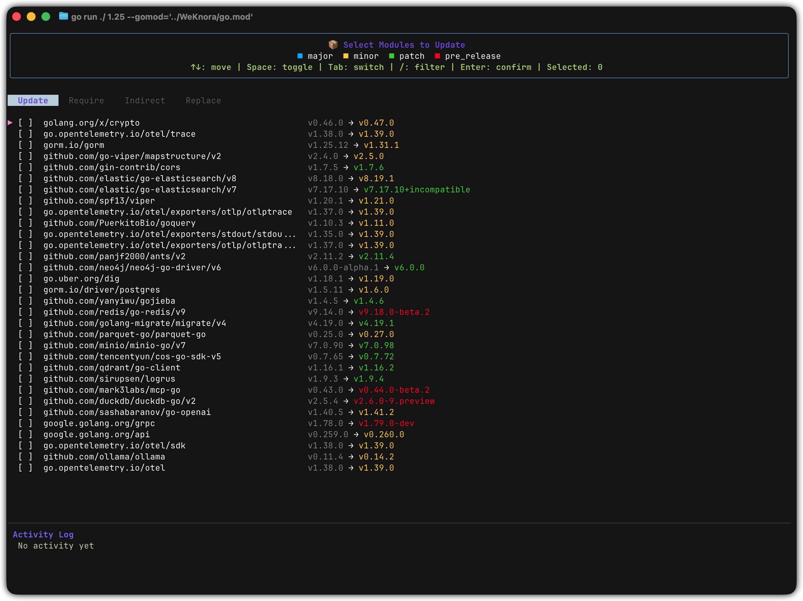
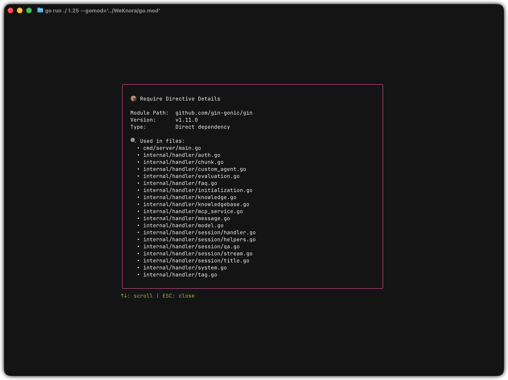
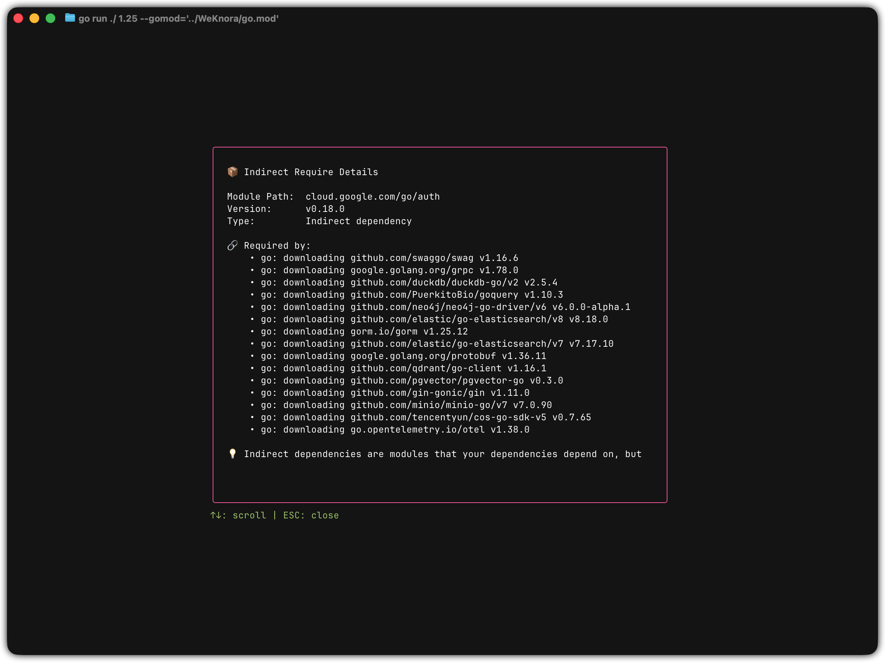

# go-mod-select

一个交互式 Go 模块版本管理工具，帮助你升/降级 Go 版本的同时确保所有依赖兼容。

灵感来自 [go-mod-upgrade](https://github.com/oligot/go-mod-upgrade)



|                                       |                                       |
| ------------------------------------- | ------------------------------------- |
|          |       |
|  |  |

## ✨ 特性

- 🎯 **智能兼容性检查** - 用 `go/version` 比较依赖的 go 指令与目标版本，逐个版本回溯到第一个能构建的
- 🎨 **四标签页 TUI** - Update（更新）/ Require（依赖）/ Indirect（间接依赖）/ Replace（替换），带条目计数
- 🔍 **详情弹窗** - 查看包使用情况和依赖链，后台加载不卡界面（支持滚动）
- ⌨️ **快捷键操作** - 空格选择、`a` 全选、`/` 过滤、Tab 切换标签页
- 🔄 **批量查询** - 版本列表与 `@latest` 元数据合并为一次子进程调用，最新版兼容时每个模块只需一次 `go list`
- 🛡️ **只读分析** - 版本探测在沙箱模块中进行，分析阶段不碰你的 go.mod / go.sum
- ↩️ **完整回滚** - 失败时 go.mod 和 go.sum 一起恢复
- 🎨 **可配置主题** - 自定义 TUI 颜色
- 📝 **结构化日志** - JSON 格式日志便于分析

## 📦 安装

```bash
# 从源码构建
git clone https://github.com/elonnzhang/go-mod-select.git
cd go-mod-select
go build -o go-mod-select

# 或使用 go install
go install github.com/elonnzhang/go-mod-select@latest
```

## 🚀 快速开始

```bash
# 基本用法 - 升级到 Go 1.25
go-mod-select 1.25

# 指定工作目录
go-mod-select 1.25 --dir /path/to/project

# 指定 go.mod 文件
go-mod-select 1.25 --gomod /path/to/go.mod

# 仅查看可更新模块（不执行更新）
go-mod-select 1.25 --dry-run

# 自动选择并应用所有兼容更新
go-mod-select 1.25 --auto

# 查看详细日志
go-mod-select 1.25 --verbose
```

不带 `--dir` / `--gomod` 时，会像 go 命令一样从当前目录向上查找模块根，所以在子包目录里直接运行也可以。

## 📖 文档

- [使用指南](./docs/usage.md) - 命令行参数、快捷键、使用场景、常见问题
- [配置说明](./docs/configuration.md) - 日志和颜色配置
- [架构设计](./docs/architecture.md) - 模块划分、并发模型、已知限制
- [更新日志](./CHANGELOG.md) - 版本记录与行为变更

## ⚠️ 三个容易意外的行为

- **不一定升到最新版**。依赖的最新版可能要求比目标 Go 更新的工具链，这时会回溯到第一个能构建的版本
- **可能是降级**。当前锁定的版本要求的工具链比目标 Go 还新时，唯一兼容的版本会更旧，标记为 `↓`。交互模式正常展示由你决定，`--auto` 默认跳过（`--allow-downgrade` 可覆盖）
- **`go mod tidy` 可能抬高 go 指令**。剩余依赖需要更新工具链时，go.mod 会停在比请求更高的版本上，工具会明确提示实际落地的版本

详见[使用指南](./docs/usage.md#注意事项)。

## ⌨️ 快捷键

| 按键                   | 功能                                               |
| ---------------------- | -------------------------------------------------- |
| `↑` / `↓` 或 `k` / `j` | 上下移动                                           |
| `g` / `G`              | 跳到首 / 尾                                        |
| `Space`                | 选择/取消（Update 标签页）或查看详情（其他标签页） |
| `a`                    | 全选/取消当前可见项（Update 标签页）               |
| `Tab` / `Shift+Tab`    | 切换标签页                                         |
| `/`                    | 过滤模式（四个标签页都可用）                       |
| `Enter`                | 确认更新（Update 标签页）                          |
| `ESC`                  | 取消过滤/清除过滤/关闭弹窗                         |
| `q`                    | 退出（过滤输入中是普通字符）                       |
| `Ctrl+C`               | 退出；更新进行中时先取消并回滚，再按一次强制退出   |

## 🎨 颜色说明

更新类型的颜色（标题栏有同样的图例可对照）：

- 🔵 **青色** - Major 更新（主版本）
- 🟡 **黄色** - Minor 更新（次版本）
- 🟢 **绿色** - Patch 更新（补丁版本）
- 🔴 **红色** - Prerelease 更新（预发布版本）

## 📁 配置文件

```
~/.go-mod-select/
├── app.log        # JSON 格式日志（全部级别，追加写入）
└── colors.json    # TUI 颜色配置（首次运行自动创建）
```

查看日志：

```bash
tail -f ~/.go-mod-select/app.log | jq .
```

自定义颜色（只写想改的键，其余沿用默认值）：

```bash
vim ~/.go-mod-select/colors.json
```

## 🤝 贡献

欢迎提交 Issue 和 Pull Request。

改动前请先跑：

```bash
gofmt -l .          # 应无输出
go vet ./...
go test ./... -race
```

测试全部离线可跑（使用临时目录，需要网络的路径以 `GOPROXY=off` 隔离）。TUI 相关改动请一并考虑真实终端下的表现——有些问题（比如过滤框里的 `q`）单元测试不会暴露。

## 📄 许可证

MIT License
